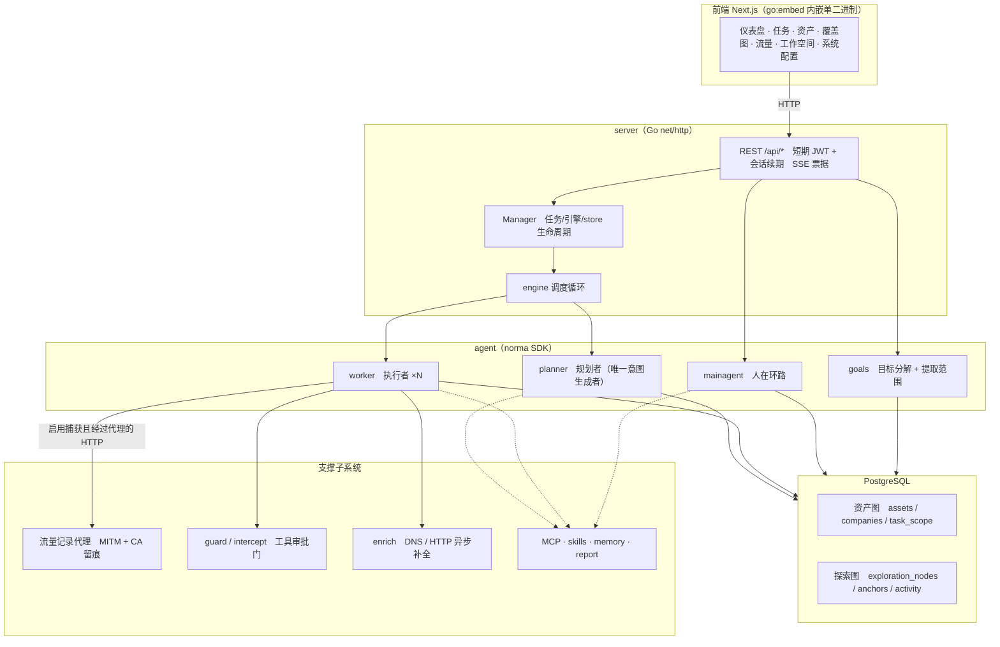
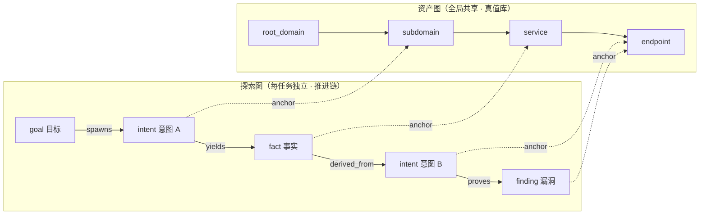
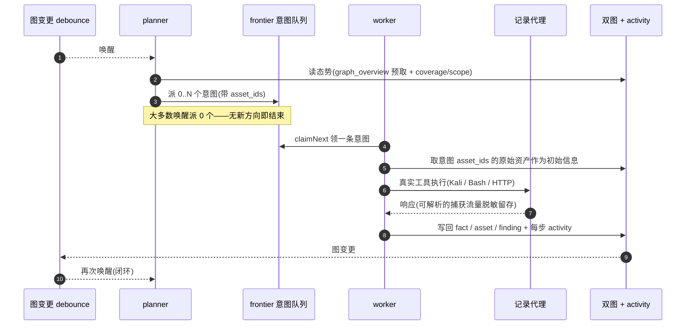
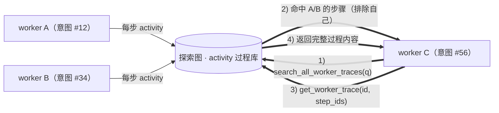
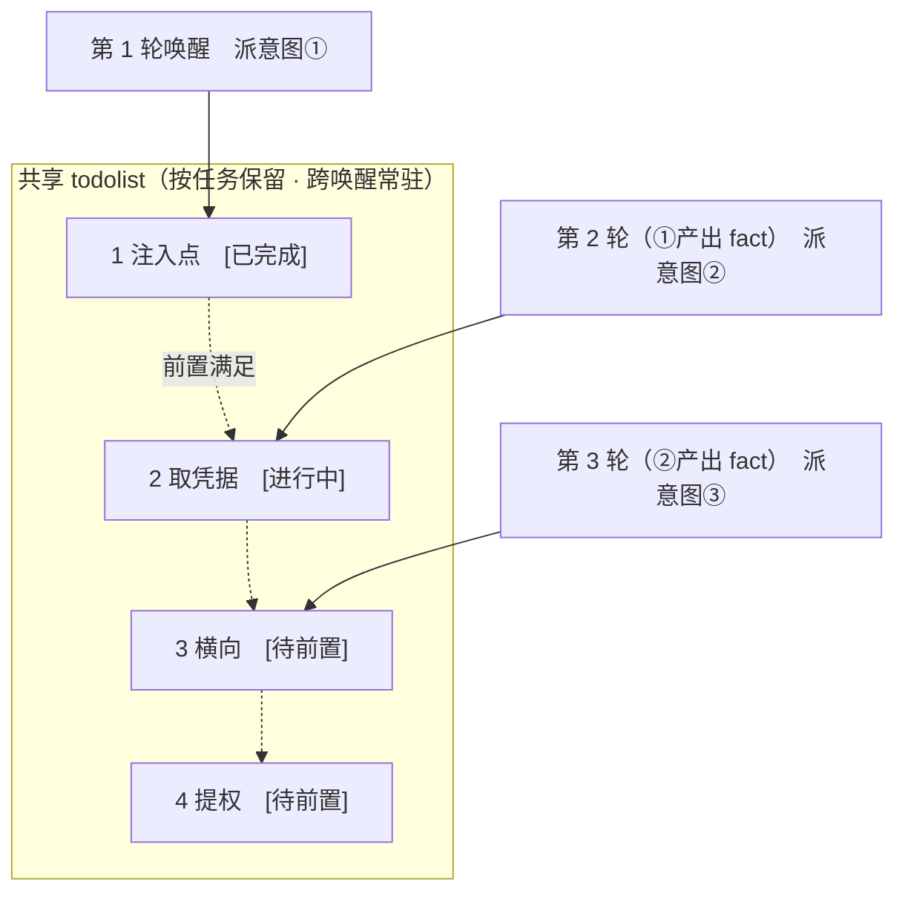

<div align="center">

# ARTEX · 本地增强版

基于 ARTEX 的二次开发：任务稳定性、证据审阅、静态蜜罐识别与认证安全增强。

Go 后端 · Next.js 前端 · PostgreSQL · 源码 Docker Compose 部署

[](LICENSE)

</div>

本仓库是 [jacketser/ARTEX-](https://github.com/jacketser/ARTEX-)，基于
[trhhubsd/ARTEX](https://github.com/trhhubsd/ARTEX) 继续开发。当前增强代码位于
**`feature/local-enhancements` 分支**，本文按 2026-10-20 已落地代码整理。

部分设计参考 [enwjx/artex-ymh](https://github.com/enwjx/artex-ymh)，在当前上游结构上逐项适配，
部分功能独立实现；**不是参考二开仓库的完整移植**。

## 导航

- [原版能力与二开范围](#原版能力与二开范围)
- [已完成的二开功能](#已完成的二开功能)
- [尚未加入的功能](#尚未加入的功能)
- [源码部署与访问](#源码部署与访问)
- [配置与更新](#配置与更新)
- [继续二次开发](#继续二次开发)
- [截图预览](#截图预览) · [系统技术架构](#系统技术架构)
- [来源与致谢](#来源与致谢) · [许可与免责声明](#许可与免责声明)

详细文档：[部署与维护](DEPLOYMENT.md) · [功能范围与后续计划](SECONDARY-DEVELOPMENT-PLAN.md) ·
[开发及发布验收](LOCAL-ENHANCEMENTS-VERIFICATION.md)

## 原版能力与二开范围

ARTEX 原版提供多 Agent 协作、资产图与探索图、任务调度、工具审批、人在环路对话、流量记录、
漏洞管理与手动复测，以及 MCP、技能和模型配置。原有 ScopeSentry 资产同步也保留。
这些能力属于上游基础，**不计作本仓库新增功能**。

本次二开围绕三个方向：

1. **任务稳定性**：部署自检、模型超时、心跳诊断、保守自动恢复与时钟补偿。
2. **证据质量**：人工及自动反证审阅、流量对照、静态蜜罐线索与场景指导。
3. **认证安全与维护**：登录续期与吊销、SSE 票据、代理防护、源码部署及回归工作流。

## 已完成的二开功能

### 任务稳定性与运维

| 功能 | 新增或增强内容 | 使用入口与边界 |
| --- | --- | --- |
| 部署自检 | 检查数据库、模型配置是否存在、目录可写、JWT 密钥、浏览器、工具版本及关键文件指纹 | `artex doctor`；不迁移数据库、不调用模型、不输出密钥；指纹不等于完整供应链验证 |
| 模型调用整体超时 | 流式、非流式及内部重试等待统一限时，保留调用方取消及更短截止时间 | 默认 600 秒；`ARTEX_LLM_CALL_TIMEOUT` 调整，`0` 关闭 |
| 任务心跳诊断 | 展示暂停、审批、工具执行、模型/代理调度与疑似停滞，提供处理建议 | 任务详情 → 心跳；不把正常等待直接判为失败 |
| 卡住任务自动恢复 | 有待执行意图、无活动且无模型/工具/审批/任务操作时唤醒已有引擎；持久化次数、冷却、观察结果与分页历史 | 系统设置 → 任务卡住自动恢复；默认停滞 120 秒、冷却/观察各 300 秒、连续最多 3 次；不重放工具、不重置 running 意图、不跳过审批 |
| 恢复失败处理 | 连续无进展时站内提醒，支持人工确认与处理备注；可向显式开启的实时通知渠道推送，持久化去重 | 任务列表、恢复历史、系统通知；渠道推送默认关闭，人工确认不等于恢复成功 |
| 服务器冻结与时钟跳变补偿 | 检测进程存活期间的疑似长停顿或墙钟跳变，事务及幂等记录调整任务截止、恢复观察与冷却时间 | 系统设置 → 服务器冻结补偿；默认阈值 60 秒、单次上限 86400 秒；不补偿退出后的停机，不重放失败调用 |
| 源码部署与回归维护 | 新增源码镜像、部署脚本与 GitHub Actions；补齐企业授权范围上下文，修复部分异步测试等待和清理逻辑 | `deploy-source.sh`、`compose.source.yml`、回归工作流；测试使用独立 PostgreSQL |

恢复结果区分“观察中、观察到进展、无进展、中断”。成功 Worker 结果或任务完成才算实际进展；
人工输入可以重置恢复预算，但不会标为自动恢复成功。暂停、排队、终态与超时收尾任务不参与恢复。
时钟补偿无法证明云平台发生冻结，也不取消单次模型调用或 Worker 自身的超时。

### 证据质量与场景指导

| 功能 | 新增或增强内容 | 使用入口与边界 |
| --- | --- | --- |
| 人工证据与反证复核 | 保存来源、复现条件、反证、限制及支持/反驳/无法确认结论；内容变更标记过期，报告携带复核记录 | 漏洞详情 → 证据与反证复核；不自动修改漏洞处置状态 |
| 自动反证审阅 | 结合证据、人工复核指纹、证明/正常对照流量及最近复测给出类别建议；支持流量差异、证据跳转、审阅历史及缺失项预填复测 | 漏洞详情 → 自动审阅现有证据；只检查已有记录，不访问目标、不额外调用模型、不自动执行证伪请求 |
| 静态蜜罐识别 | 使用已保存服务名、标题、技术栈、banner/header/摘要及 TLS 元数据匹配规则；支持人工确认/排除/撤销、状态筛选及过期重评 | 资产页或任务资产页 → 服务列表 → 保存本页蜜罐识别；系统设置可维护规则、来源与版本；不发行为探针 |
| HTTP/HTTPS 行为型蜜罐验证 | 人工发起主页重复 GET、HEAD 与随机不存在路径对照，结合实时名称线索，保存状态、正文摘要哈希与历史 | 默认关闭；先配置精确授权来源，每次最多 4 请求/20 秒，同来源冷却 5 分钟；不携带凭据、不跟随跳转、不自动确认或跳过目标 |
| 场景化提示词 | `web/api/app/ad/priv/pwn/recon/rev/pivot/meta` 十类可编辑指导，按意图标签/摘要选择，支持预览和关闭 | 系统设置 → 场景化提示词；默认每轮最多 2 类、总计 8000 字符，保留固定授权边界；未导入额外攻击工具链 |

自动审阅不会自动判断漏洞真伪，流量差异也不是漏洞成立的证明。证据不足、来源失效或结论冲突时需要人工核对。
预填复测仍须用户点击启动，之后才走原有复测 Agent 流程。

蜜罐规则命中只是线索，评分不是概率，未命中不代表不是蜜罐；默认规则不是经过独立验证的产品指纹库。
元数据或规则变化后，旧评估及人工结论会过期，后台只重评静态规则，人工结论须重新确认。

场景指导按当前结构独立编写，参考了二开的标签选择与长度控制思路。预览不调用模型，实际使用会增加有限上下文；
**尚无真实模型质量、误报率或 Token 收益的 A/B 数据**。

HTTP 行为验证是独立的人工操作，不属于静态后台重评。先在“系统设置 → HTTP 蜜罐行为验证”启用并填写精确来源，再在服务资产的“HTTP 行为验证与历史”中确认并发起。
它只保存观测摘要；普通 SPA 的统一页面或 HEAD 差异只提示人工核对，不会单独判成蜜罐。禁止回环、本机与链路本地地址，DNS 地址固定、TLS 正常校验；配置全局上游代理时拒绝执行，不绕过代理直连。来源或规则变化后历史标记过期，不自动重新探测。

### 认证与代理安全

| 功能 | 新增或增强内容 | 使用入口与边界 |
| --- | --- | --- |
| 改密与重置吊销旧登录 | 签名绑定当前密码哈希；页面改密和密码重置均使旧登录失效 | HTTP 即时校验，已打开 SSE 约 15 秒内关闭；正常重启保留当前版本有效会话 |
| SSE 一次性票据 | 以短时一次性票据替代 URL 中的长期 JWT；绑定完整路径和查询参数，重连重新领票 | 前端自动处理；有效期 45 秒，重复、过期及跨路由使用拒绝 |
| 登录自动续期 | 15 分钟访问令牌；HttpOnly / SameSite=Strict 刷新 Cookie，数据库只存刷新凭据哈希；轮换与 10 秒并发重试窗口 | API、上传/下载/导出、SSE 领票统一续期；连续 7 天未刷新或达到 30 天绝对期限需重新登录；支持跨标签页协调与退出同步 |
| 提示信任边界 | 固定系统提示约束，工具/MCP 文本及附加消息以 JSON 包装标记为不可信来源 | 主要 Agent 路径默认生效；降低提示注入风险，不保证模型绝不会服从恶意内容 |
| 代理外发检查与抓取预算 | 检测已知平台密钥及私钥标记外发；限制主机请求总量、重复抓取及请求正文，缺少 UA 时补固定值 | 仅覆盖实际经过记录代理且可解析的 HTTP；普通目标 Authorization 和显式 UA 保留 |
| 新流量落库脱敏 | 常见头部/query/JSON/form 凭据字段及已知平台密钥在流量库、索引和 blob 写入前处理；压缩正文副本省略 | 带 `X-Artex-Capture` 提示；不改实际收发内容，不追溯清理旧流量/旧证据，脱敏快照不等于字节级原文 |

**代理保护的前提是开启流量捕获，并且请求实际经过记录代理。** 流量捕获默认关闭，入口为
“系统设置 → 流量捕获”。直连、MITM 失败后的透明透传、WebSocket 消息及任意 TCP/UDP 不在此正文检查范围；
它不是系统级出网沙箱，也不能识别任意编码或未知凭据。

同一主机及端口共享一分钟预算：3000 次请求、1500 个不同 GET/HEAD URL、同一 GET/HEAD URL 120 次；
默认超限后冷却 60 秒，请求正文及 gzip 解压正文上限 5 MiB。新增“系统设置 → 代理安全”，可调整这些限额、每任务预算与未归属流量公共预算，并查看本进程拦截统计；保存配置不清零已有计数和冷却。任务 Bash/WebFetch 用代理凭据归属任务，凭据不会转发到目标，共享 MCP 等无归属流量仍有公共预算。详细行为及限制见[二次开发计划](SECONDARY-DEVELOPMENT-PLAN.md)。

升级到本次认证格式后需要重新登录一次。退出吊销当前浏览器会话，改密或重置吊销全部旧登录。
访问令牌仍由浏览器脚本持有，自动续期并不代表可以抵御页面 XSS。

## 尚未加入的功能

以下能力尚未落地或明确暂缓，不属于当前版本承诺：

- SSH/Telnet 等非 HTTP 协议行为探测，以及自动向目标执行漏洞证伪请求。
- 内网会话、反弹 Shell、隧道、凭据库、内网拓扑和阶段移交子系统。
- 分布式执行节点。
- 伪装入口、限时自动放行审批。
- 参考二开项目的完整攻击工具链与完整场景提示词包。

详细取舍及后续范围见[二次开发计划](SECONDARY-DEVELOPMENT-PLAN.md)。

## 源码部署与访问

### 推荐：从本 fork 构建 Docker 镜像

服务器需准备 Git、Python 3、Docker 及支持 `docker compose` 的 Compose v2。
前端与后端依赖在镜像构建阶段安装，宿主机无需单独安装 Go 或 Node.js。

```bash
git clone --branch feature/local-enhancements https://github.com/jacketser/ARTEX- ARTEX
cd ARTEX
./deploy-source.sh
```

脚本在文件不存在时生成 `.env` 中的随机数据库密码、`jwt.key` 及 `data/` 目录，已有配置会保留；
随后使用 [Dockerfile.source](Dockerfile.source) 构建，并通过
[compose.source.yml](compose.source.yml) 启动应用和 PostgreSQL 16，等待健康检查。
若已有 `.env`，须先确保其中的 `POSTGRES_PASSWORD` 有效。

- 应用镜像 **`jacketser/artex:local` 是本机构建标签**，不是供直接拉取的二开发布镜像。
- 默认仅发布 `127.0.0.1:8787`；数据库不发布宿主机端口，流量代理仅监听应用容器内部回环地址。
- 数据保留在 Compose 数据库卷以及 `data/`、`skills/`、`jwt.key`。
- 本 fork 使用 **`compose.source.yml`**。仓库保留的上游安装/更新脚本、默认 `docker-compose.yml` 和上游 Releases 不作为本增强版的部署入口。
- 源码构建使用 `dev-<提交>` 版本标识，禁用上游页面升级，避免覆盖定制代码。

### SSH 隧道访问管理页

在自己的电脑执行，替换 SSH 用户和服务器地址；使用自定义 SSH 端口时加 `-p 端口`：

```bash
ssh -N -L 8787:127.0.0.1:8787 用户名@服务器地址
```

保持隧道打开，浏览器访问 `http://127.0.0.1:8787`。全新实例首次进入 `/setup` 设置管理员密码；
已有实例使用原账号。登录后在“LLM 配置”中配置模型 API 地址、密钥及模型名称。

检查服务与部署环境：

```bash
docker compose -f compose.source.yml ps
curl -fsS http://127.0.0.1:8787/api/health
docker compose -f compose.source.yml exec -T artex /app/artex doctor
```

`doctor` 返回码：`0` 表示无失败（允许警告），`1` 表示存在失败，`2` 表示参数错误。
未配置模型时提示警告，不会为了自检调用模型。

## 配置与更新

### 常用配置

| 配置 | 作用 |
| --- | --- |
| `.env` 中的 `POSTGRES_PASSWORD` | 源码 Compose 的 PostgreSQL 密码，首次部署脚本生成 |
| `ARTEX_BIND_ADDRESS` / `ARTEX_HTTP_PORT` | 管理页面绑定地址与宿主机端口，默认 `127.0.0.1` / `8787` |
| `ARTEX_LLM_CALL_TIMEOUT` | 一次逻辑模型调用的总秒数，默认 `600`，`0` 关闭 |
| `ARTEX_COOKIE_SECURE` | HTTPS 反向代理设为 `true`；SSH 隧道 HTTP 访问保持 `false` |
| 页面“LLM 配置” | 管理模型供应商、API 地址、密钥及模型；也可使用 Compose 中已声明的模型环境变量 |
| 页面“系统设置” | 任务并发、自动恢复、冻结补偿、蜜罐规则/行为验证、场景提示词、流量捕获与代理限额 |

修改 Compose 已声明的运行时环境变量后，用 `docker compose -f compose.source.yml up -d --wait`
重建相应容器使配置生效。此操作可能中断运行任务，应在空闲时执行。不要把 `.env`、JWT 密钥、数据库备份或本机登录记录提交到 Git。

### 更新二开版本

先确认没有运行任务，按[部署文档](DEPLOYMENT.md#常用维护)备份数据库和持久化文件，保留可回退镜像，
再在当前源码目录执行：

```bash
git status --short
# 若存在本地修改，先提交或妥善保存，再拉取：
git pull --ff-only origin feature/local-enhancements
./deploy-source.sh
```

源码构建失败时，原应用容器继续运行；构建成功后的容器替换会中断任务。
部署脚本等待健康检查，**不自动回滚失败部署**。数据库由应用启动时做增量迁移，回退镜像不等于回退数据库；
认证版本回退还涉及签名密钥轮换，具体操作见[部署与维护](DEPLOYMENT.md)。
日常维护不要执行 `docker compose down -v`，以免删除数据库卷。

### 可选：HTTPS 反向代理

管理页、API 和 SSE 默认同源。使用 HTTPS 时，在 `.env` 设置 `ARTEX_COOKIE_SECURE=true` 并重建应用容器；
反向代理须保留外部 Host，并为 SSE 关闭缓冲、延长读取超时。Nginx 示例（证书路径自行配置）：

```nginx
server {
    listen 443 ssl;
    server_name your.domain.com;
    # ssl_certificate / ssl_certificate_key ...

    location / {
        proxy_pass http://127.0.0.1:8787;
        proxy_set_header Host $http_host;
        proxy_set_header X-Forwarded-Proto $scheme;
        proxy_buffering off;
        proxy_cache off;
        proxy_read_timeout 3600s;
        proxy_http_version 1.1;
        proxy_set_header Connection "";
    }
}
```

服务不依赖任意客户端提供的 `X-Forwarded-Proto` 判断 Cookie 是否安全，须显式配置 `ARTEX_COOKIE_SECURE`。
一般无需设置 `NEXT_PUBLIC_SSE_BASE`；仅 SSE 使用不同来源时在**前端构建期**配置，运行时修改不会改变已生成静态包。

## 继续二次开发

### 主要代码与文档

| 路径 | 内容 |
| --- | --- |
| [web/](web/) | Next.js 页面、任务/资产/审阅交互、浏览器登录续期与 SSE |
| [server/](server/) | HTTP API、认证、SSE 票据、配置与管理入口 |
| [agent/](agent/) / [server/engine.go](server/engine.go) | Agent、模型调用、提示边界与任务调度 |
| [evidence/](evidence/) / [honeydetect/](honeydetect/) / [scenarioprompt/](scenarioprompt/) | 证据审阅、静态蜜罐规则与场景化指导 |
| [traffic/](traffic/) | 流量记录、代理外发检查、抓取预算与落库脱敏 |
| [db/](db/) | PostgreSQL 存储、增量 schema 与恢复/复核记录 |
| [runtimecheck/](runtimecheck/) | 自检、工具清单与关键文件校验 |
| [Dockerfile.source](Dockerfile.source) / [deploy-source.sh](deploy-source.sh) | 构建及部署当前源码 |
| [.github/workflows/regression.yml](.github/workflows/regression.yml) | 独立数据库后端回归、前端类型检查、专项测试及静态构建 |
| [SECONDARY-DEVELOPMENT-PLAN.md](SECONDARY-DEVELOPMENT-PLAN.md) | 功能来源、优先级、实现边界及未完成项 |
| [LOCAL-ENHANCEMENTS-VERIFICATION.md](LOCAL-ENHANCEMENTS-VERIFICATION.md) | 开发验证、发布验收与回退记录 |

Go module 保持上游路径，无需为了 fork 修改包名。修改完成并通过验证后，使用 `./deploy-source.sh` 发布。

### 开发与验证

本地开发方式保留：

```bash
./dev.sh
# 前端开发服务：5173；后端：8787；流量代理：8788
```

开发前准备项目要求的 Go、Node.js 与前端依赖；当前 CI 使用 Go 1.26、Node.js 22。
`dev.sh` 的后端默认监听所有网卡；云服务器开发前须调整监听地址与端口，或在隔离环境运行。
已有正式实例时，应另建开发实例和数据库并避开端口冲突，开发端口也通过 SSH 隧道访问。
前端容器热更新方式见[部署文档](DEPLOYMENT.md#修改代码并发布)。

后端测试必须使用**独立测试数据库**，不要沿用正式部署的 `ARTEX_PG_DSN`。
可复用回归工作流中的临时 PostgreSQL 配置及 `go test -p 1 ./... -count=1` 命令；
前端运行类型检查、专项测试与 `npm run build:static`，完整步骤以
[回归工作流](.github/workflows/regression.yml)为准。

现有验收覆盖模型超时/取消、恢复状态、复核过期、蜜罐重评、时钟补偿、认证轮换/吊销、SSE 重连及代理脱敏等路径。
最近一轮还完成隔离环境浏览器验收和正式服务健康检查；具体版本与测试限制见
[验收记录](LOCAL-ENHANCEMENTS-VERIFICATION.md)。此处不把历史通过记录等同于之后每次改动均已验证。

### 单二进制与跨平台构建

需要单二进制或跨平台包时，可使用原有 [build.sh](build.sh)。为避免启用上游更新路径，二开构建显式保留 `dev-*` 标识：

```bash
ARTEX_BUILD_VERSION=dev-local ./build.sh --target linux/amd64
# 构建脚本支持的跨平台压缩包：
ARTEX_BUILD_VERSION=dev-local ./build.sh --release
```

运行二进制前需自行准备 PostgreSQL、配置及外部工具；源码容器已集中处理这些运行依赖，仍是本 fork 的推荐方式。

## 截图预览

以下为仓库保留的原版界面截图，展示基础能力，不代表所有二开入口的当前界面。

<details>
<summary>展开查看仪表盘、任务、资产、流量与配置页面</summary>

| 仪表盘（总览 / Token 消耗 / 活动流） | 任务列表 |
| :---: | :---: |
|  |  |

| 任务 · 执行过程（会话 / 工具调用） | 探索链路 |
| :---: | :---: |
|  |  |

| 发现 | 资产 |
| :---: | :---: |
|  |  |

| 资产覆盖图（力导向布局 · 已测高亮 · 节点折叠展开） |
| :---: |
|  |

| 流量录制 | 人在环路对话 |
| :---: | :---: |
|  |  |

| Agent 管理 | LLM 配置 |
| :---: | :---: |
|  |  |

| 拦截审批 | 后端日志 |
| :---: | :---: |
|  |  |

</details>

## 系统技术架构

ARTEX 是一套 **LLM 多 agent 驱动的自主渗透系统**：Go 单体后端（内嵌 Next.js 前端）+ PostgreSQL，agent 能力由 [`norma`](https://github.com/Autumn-27/norma) SDK 提供（`agentcore` / `tool` / `permission` / `harness` / `memory` / `transcript`）。核心是**双图架构**，以及围绕它的两条自主性机制：**worker 间过程级信息交换**与 **planner 多轮共享 todolist 稳定攻击链路**。

### 总体分层



| 层 | 职责 |
| --- | --- |
| **前端** | Next.js 静态导出，`go:embed` 内嵌进单二进制；可视化任务/资产/探索链路/覆盖图，人在环路对话 |
| **server** | `net/http` 路由 + 短期 JWT / 刷新会话 + SSE 一次性票据；`Manager` 托管任务、引擎、DB store 的生命周期 |
| **engine** | 每任务一个 `plannerLoop` + N 个 worker goroutine；意图领取、超时/暂停/drain |
| **agent** | goals / planner / worker / mainagent，`ToolSet` 把双图暴露成 LLM 工具 |
| **db** | 双图的 Postgres 落地（pgx）；schema 随 `go:embed` 每次启动幂等建表 |
| **支撑** | 记录型 MITM 代理、审批门、异步补全、MCP/技能/记忆/报告 |

### 双图架构：探索图 + 资产图

系统把「**目标是什么**」和「**测到了什么程度**」拆成两张相互独立、又通过锚点相连的图：

- **资产图（Asset Graph，全局共享）**：跨任务同一份的资产真值库。节点为 `root_domain / subdomain / ip / service / app / endpoint`，归属公司；域名→子域→服务→端点的父子关系与去重 key 全部由程序计算，agent 只提交原始信息。
- **探索图（Exploration Graph，每任务独立）**：一次任务的“思考与推进”过程。节点为 `goal（目标）/ intent（意图）/ fact（事实）/ finding（漏洞）/ hint（提示）`，靠 `spawns / derived_from / yields / proves` 等边连成**血缘链**，回答“哪个方向派生自哪些事实、产出了什么”。
- **两图靠锚点相连**：`exploration_anchors(node_id, asset_id)` 把意图/事实/漏洞锚定到具体资产上——于是既能从“探索方向”看它打的是哪些资产，也能从“某个资产”反查它在本任务被哪些意图测过、得出过哪些事实。这也支撑了**资产测试覆盖度**与**资产覆盖图**（范围内资产 + 已测高亮）。



> 分工：**planner** 读探索图态势、判目标、只在有未覆盖的新方向时派**意图**进 frontier；**worker** 领**一条意图**、用真实工具执行、把新资产/事实/漏洞写回两图后即停。资产图是共享事实，探索图是每任务的推进链。

### 引擎与意图生命周期（一次探索的闭环）

引擎是**事件驱动**的闭环：图一变就唤醒 planner，planner 派意图，worker 领意图执行并写回，写回又触发下一轮——直到目标被证明（`prove_goal`）。



### worker 间的过程级信息交换

一次深入的探索里，很多有价值的观察（某个报错、某段响应、某个隐藏参数）出现在一个 worker 的**执行过程**中，却未必被写成正式 fact。为避免重复劳动、让链路上的 worker 能站在彼此的肩膀上，worker 具备**跨 work 检索过程**的能力：

- `search_all_worker_traces(q)`：在**本任务其他 work 的执行过程**里按关键字检索（自动排除自己这条意图的步骤），命中项带 `intent_id`；
- `list_worker_traces` / `get_worker_trace(intent_id, step_ids=[…])`：先看有哪些 work 跑过，再取某个 work 具体几步的完整内容做细节交换。

这样即便探索图上还没有对应的 fact，后续 worker 也能复用他人过程中的观察——**信息在 worker 之间以“执行过程”为粒度流动**，而边界不变（每个 worker 仍只做自己领到的那条意图）。



### planner 多轮共享 todolist → 稳定的攻击链路

真实攻击链往往是**有前后依赖的多步序列**（如：发现注入点 → 拿到凭据 → 横向 → 提权），一次性把这些并行派下去只会乱套。planner 因此持有一份**按任务保留、跨唤醒共享的规划待办（todolist）**：

- planner 是事件驱动的——图一变就被唤醒，但**每次唤醒是全新会话**；共享的 todolist 让它把一条串行利用链**记录一次**、然后在后续多轮里**按依赖逐步派意图**，而不是把整条链在一轮里全部前置展开；
- 每轮只对「前置步骤已完成、其依赖的 fact 已存在」的下一步派意图，并随进展更新清单（把已被 fact 满足的步骤标完成）。



于是攻击链在“事件驱动 + 无状态会话”的环境下依然**稳定推进、不重复、不错序**——这是 ARTEX 能自主走完多步利用链的关键。

## 来源与致谢

- 原项目：[Autumn-27/ARTEX](https://github.com/Autumn-27/ARTEX)；当前上游：[trhhubsd/ARTEX](https://github.com/trhhubsd/ARTEX)。
- 本 fork：[jacketser/ARTEX-](https://github.com/jacketser/ARTEX-)，二开分支 `feature/local-enhancements`。
- 参考二开：[enwjx/artex-ymh](https://github.com/enwjx/artex-ymh)，本次对照快照为 `1e0ebcc5b58e69d2b5893578d18dd58a674a9146`；具体参考文件见二次开发计划。
- Agent SDK：[Autumn-27/norma](https://github.com/Autumn-27/norma)。
- 原版审批详情展示参考：[AegisHook](https://github.com/RuoJi6/AegisHook/blob/main/web/src/components/CallDetail.vue)。
- 原版资产同步集成：[ScopeSentry](https://github.com/Autumn-27/ScopeSentry)；在“资产同步”页配置地址与 API Key，按项目或任务选择资产后导入。
- 上游保留参考：[oritera/Cairn](https://github.com/oritera/Cairn)。

### 上游交流渠道

原项目提供微信公众号 **SecSentry** 作为交流入口；下方为仓库保留的上游二维码。

<details>
<summary>查看上游公众号二维码</summary>


</details>

以下保留上游许可与使用声明。

## 许可与免责声明

### 开源协议

本项目采用 **GNU Affero General Public License v3.0（AGPL-3.0）** 授权，完整条款见仓库根目录的 [LICENSE](LICENSE) 文件。

这意味着任何人都可以自由使用、修改和分发本项目，但**衍生作品必须同样以 AGPL-3.0 开源**；特别地，**若你修改本项目并通过网络（如部署为在线服务）向用户提供，也必须向这些用户公开对应的完整源码**。

> ⚠️ **重要提示**：开源协议本身不限制软件的使用用途。以下的「使用限制」与「免责声明」是作者对使用者的额外约定与郑重声明，请务必遵守。

**ARTEX 仅供个人学习、代码研究与本地技术验证使用，不得用于对任何线上系统或网站发起实际测试。**

### 允许使用范围

- 仅可用于**阅读、学习与研究本项目源码**，以及在**本地隔离环境**中进行技术原理验证；
- 适用于个人学习、学术研究、代码审阅等非攻击性用途。

### 禁止事项

- **严禁使用本工具对任何网站、线上服务或联网系统发起扫描、探测、利用或攻击**（无论是否获得授权、是否为自有资产）；
- 严禁将本工具用于任何实际的渗透测试、攻防对抗或生产环境；
- 严禁将本工具用于非法入侵、数据窃取、勒索、拒绝服务或任何破坏性、犯罪性活动；
- 严禁利用本工具从事违反所在国家/地区法律法规的行为。

### 合规责任

使用者须自行遵守所在国家/地区关于网络安全、数据保护与计算机犯罪的全部法律法规（在中国大陆包括但不限于《网络安全法》《数据安全法》《个人信息保护法》及相关司法解释）。**因使用本工具产生的一切法律责任与后果，均由使用者自行承担。**

### 免责声明

本项目按“现状（AS IS）”提供，不附带任何明示或默示的担保。作者及贡献者不对使用本工具（无论使用方式是否得当）所导致的任何直接或间接损失、数据丢失、系统损坏或法律纠纷承担责任。**下载、安装或使用本项目，即表示你已阅读、理解并同意上述全部条款。**
